# Enterprise Active Directory & Group Policy Architecture

Çok Şubeli Kurumsal Altyapı Tasarımı, Delegasyon, GPO Kısıtlamaları ve Script Otomasyonu Projesi

---

## 1. Executive Summary (Proje Özeti)

Bu projede, çok şubeli bir kurumsal yapının (Ankara ve Bursa şubeleri) Active Directory Domain Services (AD DS) hiyerarşisi, yetkilendirme (Delegation of Control), erişim kısıtlamaları (Logon Hours & GPO Restrictions), oturum açma politikaları ve otomasyon senaryoları (Startup Scripts) uçtan uca tasarlanmış ve canlı ortam simülasyonunda başarıyla test edilmiştir.

### 📌 PROJE MİMARİ ÖZETİ
- **Domain Mimarisi:** `can.com`
- **Domain Controllers:** DC1 ve ADDC (Yedekli Yapı)
- **Lokasyonlar:** Ankara & Bursa Şubeleri (OU Yapılanması)
- **Güvenlik & Politika:** GPO, AppLocker, Delegation of Control, Logon Hours

---

## 2. Domain & Organizational Unit (OU) Hiyerarşisi

Kurumsal yapının yönetilebilirliğini artırmak ve Group Policy Objelerini (GPO) doğru birimlere uygulayabilmek adına esnek ve ölçeklenebilir bir OU mimarisi kurulmuştur.

- **ANKARA -> SATIS (OU):** Ankara Şubesi Satış Birimi (AnkaraSatis Grubu, as1, as2, as3 kullanıcıları)
- **ANKARA -> YONETIM (OU):** Ankara Şubesi Yönetim Birimi (AnkaraYonetim Grubu, ay1, ay2 kullanıcıları)
- **ANKARA -> BILGISAYARLAR (OU):** Şubeye ait istemci bilgisayarlar (SERVER-2)
- **ANKARA Bölge Yöneticileri:** Ankara bölgesi yerel yöneticileri (ankaraadmin, ankaraadmin1)
- **BURSA -> SATIS (OU):** Bursa Şubesi Satış Birimi (BursaSatış Grubu, bs1, bs2 kullanıcıları)
- **BURSA -> YONETIM (OU):** Bursa Şubesi Yönetim Birimi (BursaYönetim Grubu, by1, by2 kullanıcıları)
- **BURSA Bölge Yöneticisi:** Bursa bölgesi yerel yöneticisi (bursaadmin)

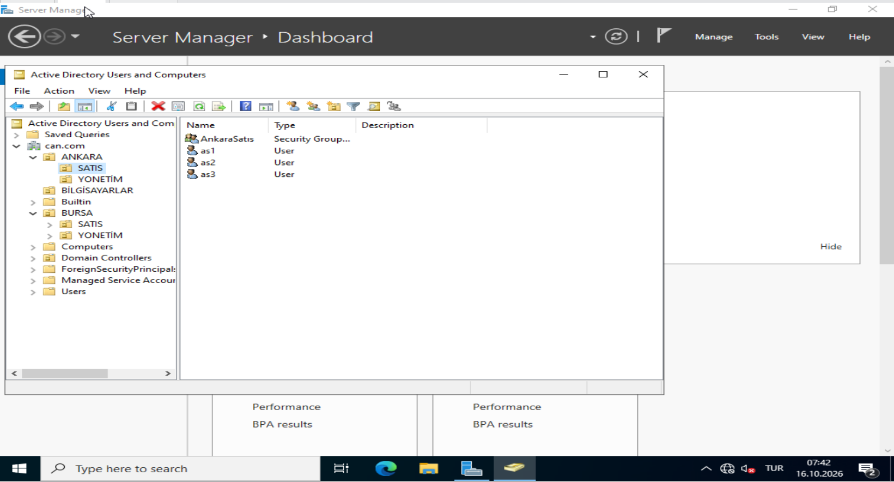
*Görsel 2.1: Active Directory Users and Computers (ADUC) - ANKARA OU ve Bölge Yöneticileri*

*Görsel 2.2: ANKARA -> SATIS OU Kullanıcıları ve AnkaraSatis Güvenlik Grubu*

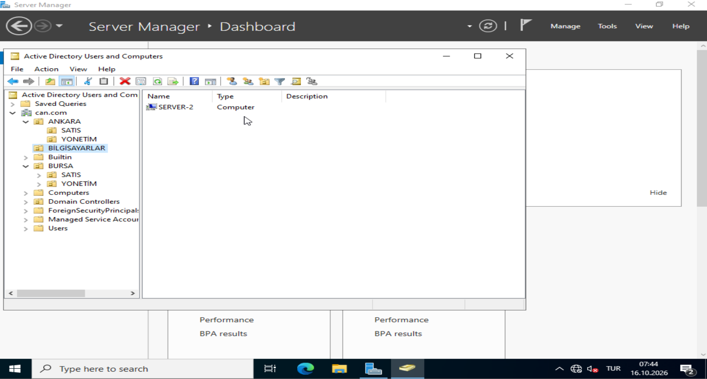
*Görsel 2.3: ANKARA -> YONETIM OU Kullanıcıları ve AnkaraYonetim Güvenlik Grubu*

*Görsel 2.4: BURSA OU Genel Yapısı ve bursaadmin Kullanıcısı*

*Görsel 2.5: BURSA -> SATIS OU Kullanıcıları ve BursaSatış Güvenlik Grubu*

*Görsel 2.6: BURSA -> YONETIM OU Kullanıcıları ve BursaYönetim Güvenlik Grubu*

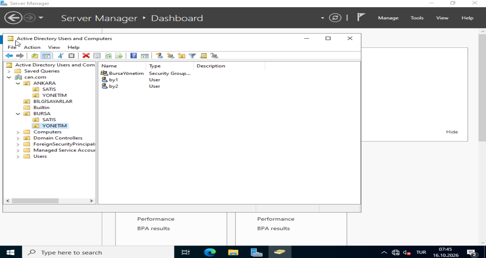
*Görsel 2.7: BILGISAYARLAR OU - Domain Üyesi İstemci Bilgisayarlar (SERVER-2)*

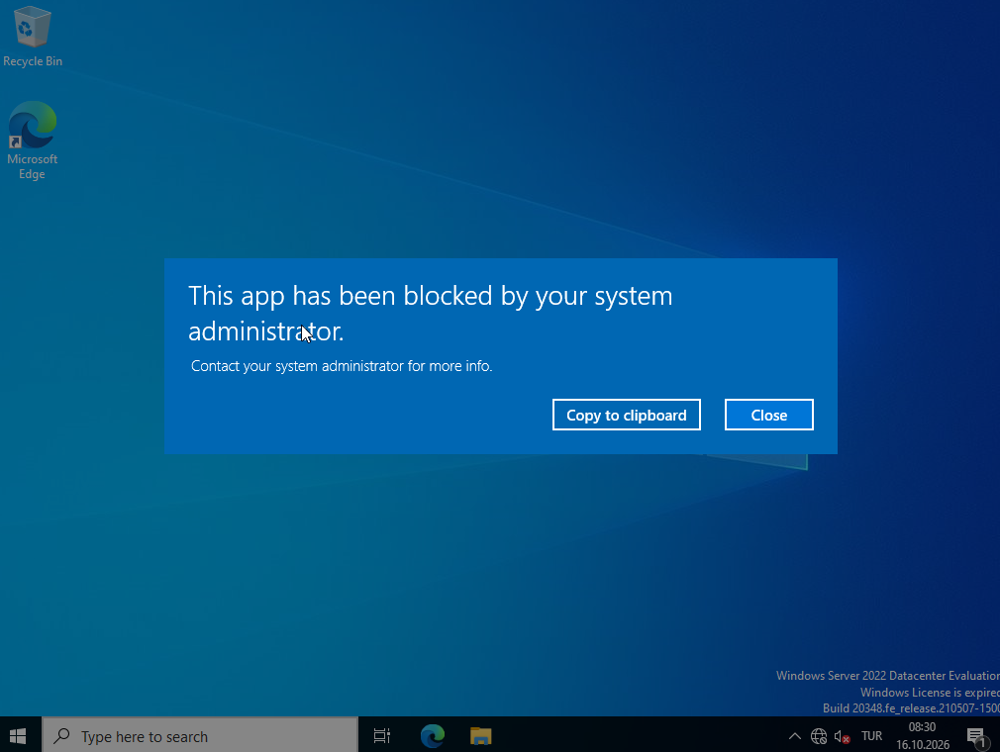
*Görsel 2.8: Domain Controllers OU - DC1 ve ADDC Yapısı*

---

## 3. Delegasyon ve Yetki Devri (Delegation of Control)

Principle of Least Privilege (En Az Yetki Prensibi) doğrultusunda, Domain Admin yetkisi vermeden şube bazlı yönetim olanağı sağlanmıştır.

Ankara OU'su üzerinde `ankaraadmin1` kullanıcısına nesne oluşturma, silme ve yönetme yetkisi devredilmiştir. Böylece şube yöneticileri yalnızca kendi bölgelerindeki kullanıcı ve grupları yönetebilirken, ana domain yapısının güvenliği korunmuştur.

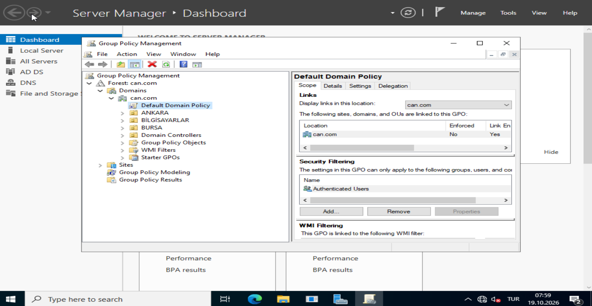
*Görsel 3.1: Delegation of Control Wizard - Yetki Devredilecek Kullanıcı Seçimi (ankaraadmin1)*

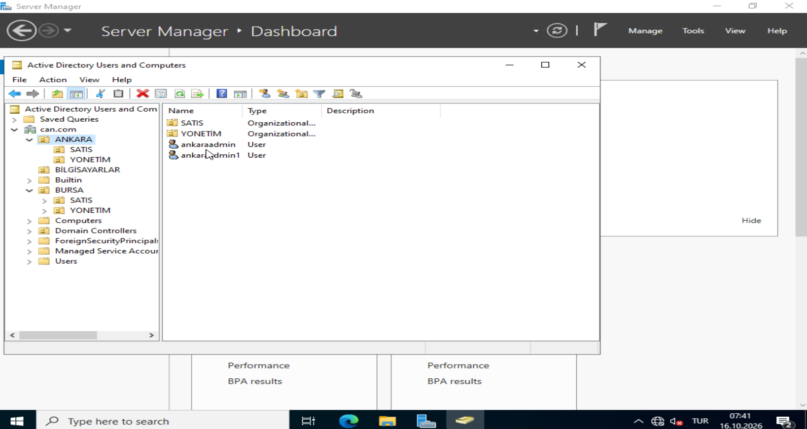
*Görsel 3.2: Delegation of Control Wizard - Özelleştirilmiş Yetki Atamaları (Full Control, Read/Write)*

---

## 4. Zaman Bazlı Oturum Yönetimi (Logon Hours Control)

Güvenlik politikaları gereği, belirli personellerin (örneğin `as2` kullanıcısı) mesai saatleri dışında sisteme giriş yapması engellenmiştir.

Kullanıcı Özellikleri (User Properties) -> Account -> Logon Hours sekmesinden Pazar günleri ve mesai dışı saatlerde logon hakları kısıtlanarak 'Logon Denied' olarak ayarlanmıştır.

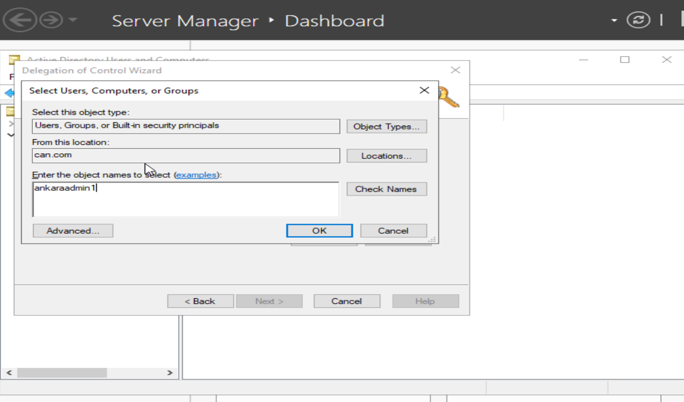
*Görsel 4.1: as2 Kullanıcısı İçin Logon Hours Yapılandırması (Erişim Kısıtlamaları)*

---

## 5. Kurumsal İnteraktif Oturum Açma Bildirimi (Interactive Logon Banner)

Sisteme giriş yapmaya çalışan tüm kullanıcılara yasal sorumluluk ve karşılama mesajı gösterilmesi amacıyla Group Policy düzenlemesi yapılmıştır.

**GPO Yolu:** `Computer Configuration -> Policies -> Windows Settings -> Security Settings -> Local Policies -> Security Options`
- **Interactive logon: Message title for users attempting to log on:** MERHABA
- **Interactive logon: Message text for users attempting to log on:** ŞİRKETİMİZE HOŞ GELDİNİZ. YETKİSİZ İŞLEMLER KAYIT ALTINA ALINACAKTIR.

*Görsel 5.1: Group Policy Management Editor - Security Options Politika Yapılandırması*

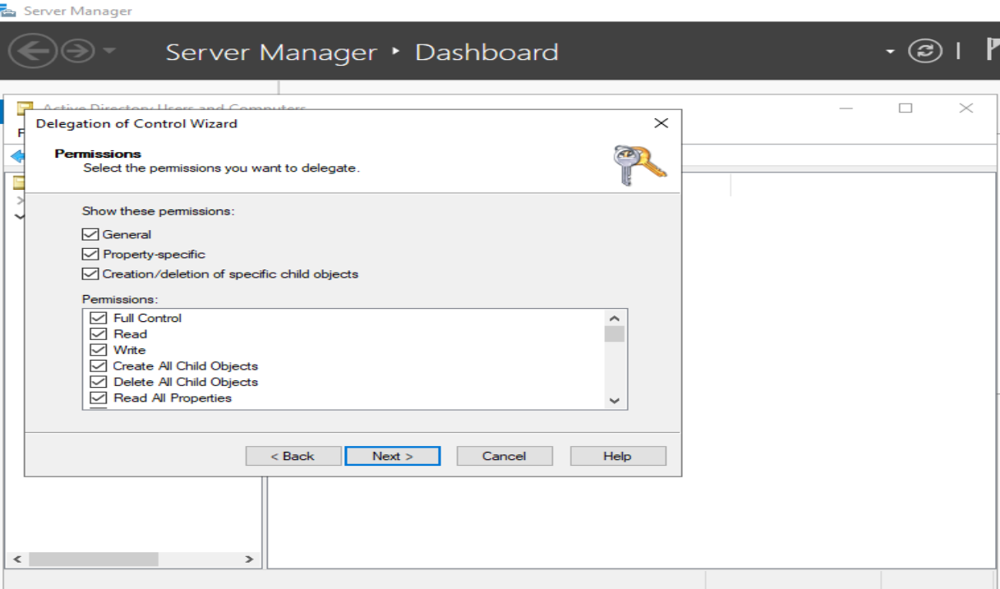
*Görsel 5.2: Message Title Ayarı ('MERHABA')*

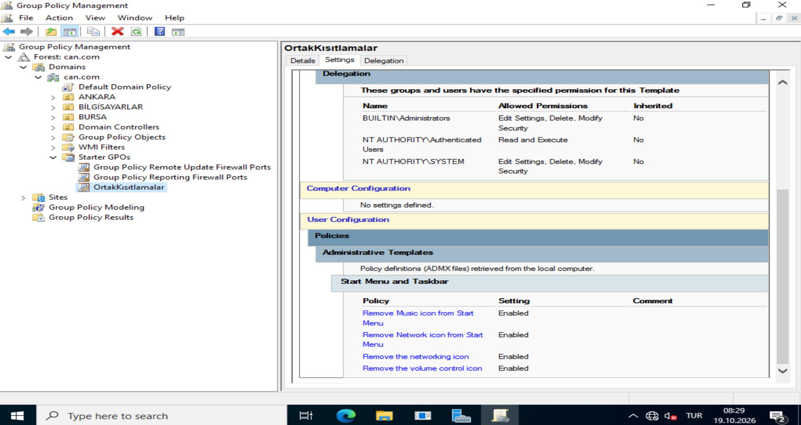
*Görsel 5.3: Message Text Ayarı ('ŞİRKETİMİZE HOŞ GELDİNİZ. YETKİSİZ İŞLEMLER KAYIT ALTINA ALINACAKTIR.')*

*Görsel 5.4: İstemci Tarafında Oturum Açma Öncesi Görüntülenen İnteraktif Uyarı Ekranı*

---

## 6. Şube Bazlı Oturum Açma Senaryoları (Startup Scripts & Automation)

Kullanıcılar domain cihazlarına giriş yaptıklarında bulundukları şubeye özel bilgilendirme mesajı alacak şekilde VBScript script'leri hazırlanmış ve GPO üzerinden Logon Script olarak dağıtılmıştır.

- **Ankara Şubesi VBScript (Ankara Script):** `msgbox "Ankara Subemize Hosgeldiniz."`
- **Bursa Şubesi VBScript (Bursa Script):** `msgbox "Bursa Subemize Hosgeldiniz."`

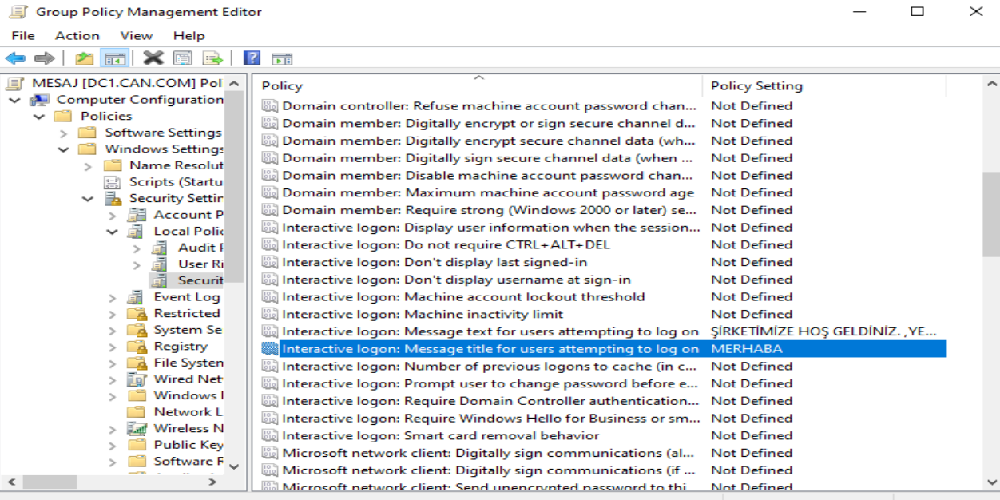
*Görsel 6.1: Ankara Şubesi İçin Hazırlanan VBScript Kod Yapısı*

*Görsel 6.2: Bursa Şubesi İçin Hazırlanan VBScript Kod Yapısı*

*Görsel 6.3: Ankara Şubesi Kullanıcı Oturumunda Çalışan Karşılama Mesajı*

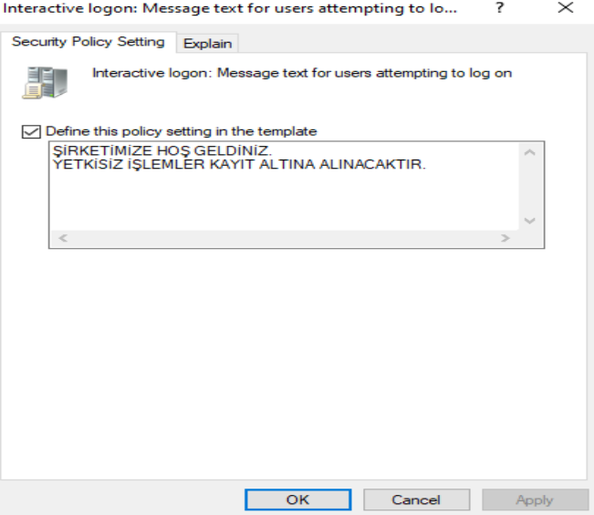
*Görsel 6.4: Bursa Şubesi Kullanıcı Oturumunda Çalışan Karşılama Mesajı*

---

## 7. Sistem Kısıtlamaları ve AppLocker / GPO Güvenlik Politikaları

Sistem güvenliğini ve son kullanıcı standartlarını korumak için Starter GPO ve Custom GPO yapıları oluşturulmuştur.

### Başlat Menüsü ve Görev Çubuğu Kısıtlamaları (OrtakKısıtlamalar GPO)
**GPO Yolu:** `User Configuration -> Administrative Templates -> Start Menu and Taskbar`
- **Remove Music icon from Start Menu:** Enabled
- **Remove Network icon from Start Menu:** Enabled
- **Remove the networking icon:** Enabled
- **Remove the volume control icon:** Enabled

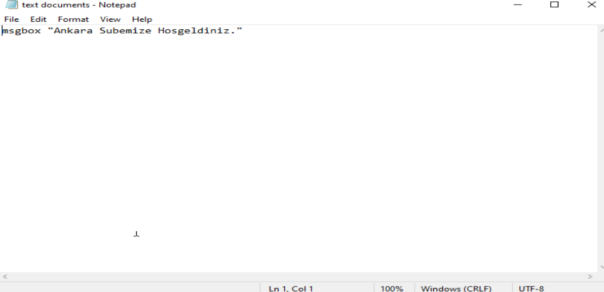
*Görsel 7.1: Starter GPO Yapılandırması ve OrtakKisitlamalar Şablonu*

*Görsel 7.2: OrtakKisitlamalar GPO Ayarları ve Uygulanan Politika Detayları*

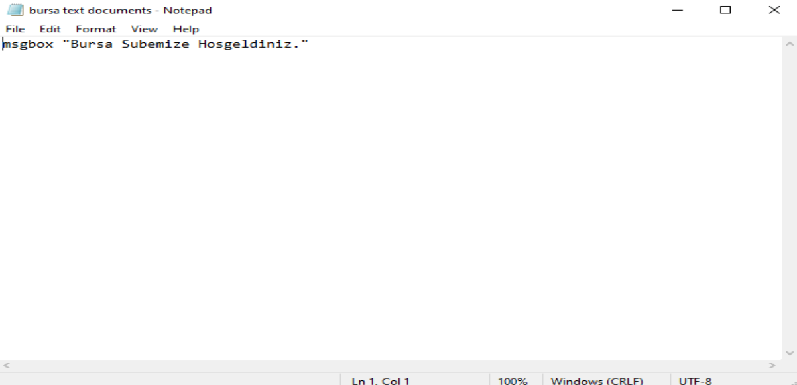
*Görsel 7.3: İstemci Ekranında Engellenen İşlem Uyarısı (Restrictions Cancelled)*

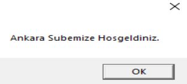
*Görsel 7.4: Uygulama Engelleme Uyarısı (This app has been blocked by your system administrator)*

---

## 8. Sonuç ve Kazanımlar (Key Takeaways)

Bu proje kapsamında gerçekleştirilen çalışmalar ile kurumsal seviyede bir Active Directory altyapısı ve güvenlik mimarisi uçtan uca hayata geçirilmiştir:
- Çok lokasyonlu şirket mimarilerine uygun esnek OU ve GPO hiyerarşisi kurulmuştur.
- Delegation of Control mekanizması ile en az yetki prensibine uygun bölge yönetimi sağlanmıştır.
- Logon Hours ve Interactive Logon Banner düzenlemeleri ile erişim denetimi ve yasal uyumluluk elde edilmiştir.
- VBScript ve GPO Administrative Templates ile kullanıcı deneyimi ve masaüstü güvenlik standartları otomatize edilmiştir.

---

## 🚀 Gelecek Fazlar (Roadmap)

- [x] Faz 1: AD DS, OU Hierarchy, Delegation, GPO & Script Automation
- [ ] Faz 2: LAPS (Local Administrator Password Solution) Entegrasyonu
- [ ] Faz 3: BitLocker & Central Recovery Key Management
- [ ] Faz 4: Event Log Forwarding & Security Auditing
